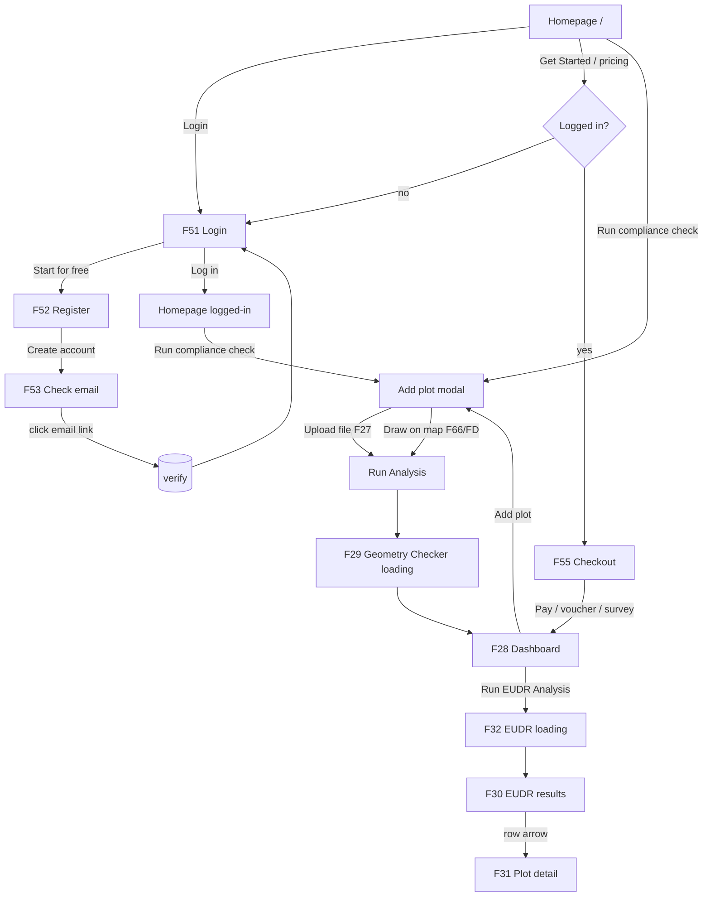

# Averos — Product Requirements Document (PRD)

| | |
|---|---|
| **Product** | Averos — Land/plot geospatial compliance platform (EUDR) |
| **Document** | PRD v1.0 — reflects the current `averos-web` build |
| **Date** | 2026-06-15 |
| **Status** | MVP built & verified; some analyses pending backend Earth Engine auth |
| **Owner** | Averos team |

---

## 1. Overview

Averos turns a land/plot boundary (GeoJSON or hand-drawn polygon) into a structured
compliance report. The flagship use case is **EUDR (EU Deforestation Regulation)
compliance**: for each plot, Averos checks geometry validity and runs satellite-backed
analyses (deforestation, land legality, GHG emissions, rainfall), then presents the
results in a dashboard with a per-plot detail view.

This document focuses on the **end-to-end UI/UX flow** as implemented, plus the
supporting functional, data, and integration requirements.

---

## 2. Goals & non-goals

**Goals**
- Let a user go from "I have a plot boundary" to "I have a compliance verdict" in minutes.
- Make the analysis selection explicit (user chooses what to run).
- Deliver an audit-ready, scannable report (dashboard + per-plot detail).
- Frictionless onboarding (email sign-up, Google option) and a pay-as-you-go/subscription model.

**Non-goals (current build)**
- Real payment capture (checkout is a UI prototype; no gateway charge).
- Production-grade identity (file-based user store; no SSO/CAM, no passkeys).
- Team/multi-tenant management, RBAC, billing history.

---

## 3. Personas

| Persona | Need |
|---|---|
| **Smallholder / estate operator** | Quick EUDR check on a plot before selling/exporting. |
| **Sustainability / compliance officer** | Audit-ready evidence (deforestation, legality) per plot. |
| **Supply-chain analyst** | Bulk plots, risk screening, exportable data. |

---

## 4. Scope

**In scope (built)**
- Marketing homepage with analysis selection.
- Auth: email register → email verification → login → logout.
- Add plot: GeoJSON upload **or** draw-on-map (OpenLayers).
- Geometry validation + dashboard summary.
- EUDR analysis run (selected analyses) → results table → per-plot detail.
- Checkout (plan + voucher + survey discount + payment form UI).

**Coming soon (shown, not active)**
- Biomass, Fire Detection, Crop Health, Mill Nearby.

**Out of scope (current)**
- CAM login, passkey login, real Google OAuth, real payment, password reset.

---

## 5. Information architecture (routes)

| Route | Screen | Auth | Notes |
|---|---|---|---|
| `/` | Homepage (marketing + analysis selection) | public | Auth-aware navbar |
| `/login` | **F51** Login | public | Tencent-style two-pane |
| `/register` | **F52** Create account | public | |
| `/verify-sent` | **F53** Check your email | public | |
| `/api/auth/verify` | Email link handler → `/login?verified=1` | public | |
| `/dashboard` | **F28** Plot dashboard | public* | Reads client store |
| `/dashboard/eudr` | **F30** EUDR results table | public* | Sidebar layout |
| `/dashboard/eudr/[id]` | **F31** Per-plot EUDR detail | public* | Sidebar layout |
| `/checkout` | **F55–F57** Choose plan & pay | **required** | Redirects to `/login?next=/checkout` |

\* Dashboard routes are not server-gated today; they rely on client plot state. Gating can be added if required.

**Modal / overlay screens (not routes):**
- **F27 / F65 / F66 / FD** — "Add plot data" modal (upload row / draw map / map / fullscreen map).
- **F29** — "Analyzing your land" (Geometry Checker) interstitial.
- **F32** — "Analyzing your land" (EUDR) interstitial.

---

## 6. UX FLOWS (primary section)

### 6.1 Flow map



### 6.2 Flow A — Discovery → Account → Login

1. **Homepage (`/`)** shows the value prop and the EUDR analysis selection.
   - Logged-out navbar: **Login**. Logged-in navbar: **Hi {name} · Go to dashboard · Logout**.
2. **Login (F51)** — Tencent Cloud-style two-pane:
   - Left card: *Log in with email* → Email, Password (show/hide), **Log in**, divider, **Log in with Google**, `Sign up | Forgot password`.
   - Right: Averos marketing ("EUDR compliance checks, ready in minutes") + **Start Free**.
   - No "Log in as CAM" / "Log in with Passkey".
3. **Register (F52)** — Continue with Google, or Name / Email / Password / Password Confirmation → **Create account**.
4. **Verify email (F53)** — "You're ready to go! / Check your email to begin." Includes **resend the email**.
5. User clicks the verification link → account marked verified → redirected to **F51** with a success banner.
6. **Log in** → lands on **homepage** (`/`), navbar now in logged-in state.

**Rules**
- Login requires a **verified** email.
- `?next=` is sanitized to internal paths only (open-redirect guard).
- Verification email is sent via Brevo SMTP (see §10).

### 6.3 Flow B — Add plot & geometry check (F27 → F29 → F28)

1. From homepage, the user **selects analyses** (Deforestation, Land Legality, GHG, Rainfall — all pre-checked) and clicks **Run compliance check** (or **Add plot** on the dashboard).
2. **Add plot data modal** opens with two tabs:
   - **Upload file** — drag/drop or browse a `.geojson`/`.json` (≤10 MB). After selection it shows the **uploaded file row (F27)**: file icon, name, size, ✓, delete. **Run Analysis** enables.
   - **Draw on map (F66)** — OpenLayers map (OSM **and** Google Satellite basemaps), tools: Grab / Add Point / Undo / Redo / Reset, Search location (Nominatim), Use current location, zoom. Live **Polygon point count + Total Area (ha)**. **Expand → fullscreen (FD)** with floating toolbar + bottom card (stats + Run Analysis).
3. **Run Analysis** → **F29 "Analyzing your land" (Geometry Checker)** interstitial. The loading bar tracks the **real** API call (`POST /api/analysis/validate-geometry`), then completes.
4. Lands on **Dashboard (F28)**:
   - "Plot Uploaded" banner; **Total Plot Area** (sum ha); **Add plot** tile.
   - Stat tiles: **Total Plot / Valid / Invalid**.
   - **Map** showing the plot(s), fit-to-extent (OSM/Satellite, expand, zoom).
   - **Plots table**: No, Area, Duplicate Vertices, Zero Area, Self-Intersection (from the API's geometry check).
   - **Run EUDR Analysis** CTA.

### 6.4 Flow C — EUDR analysis (F32 → F30 → F31)

1. **Run EUDR Analysis** → **F32 "Analyzing your land" (EUDR)** interstitial. The step pills reflect **exactly the analyses the user selected** (e.g. all four: Deforestation Analysis · Land Legality Analysis · GHG Emission · Rainfall Analysis). Only the selected endpoints are called, in parallel.
2. **EUDR results (F30)** — sidebar workspace (Averos · Overview · user card · Change Password · Logout). Table per plot: No, Area, Deforestation, Land Legality, Risk, and a **→** to open detail.
3. **Plot detail (F31)** — same sidebar; header "EUDR Analysis" + back link; **map** of the plot; **Plot Information** card (name, area, vertices, geometry, status, risk, country, centroid); tabbed results: **Rainfall · Deforestation · GHG Emissions · Legality Analysis**, each with a verdict banner + metric tiles. Tabs without data show "Not analyzed yet".

**Rules**
- Selection on the homepage controls which analyses run in F32 (unchecked = not called, no tile).
- Failed/unavailable analyses degrade gracefully (no crash; "Not analyzed yet").

### 6.5 Flow D — Checkout & payment (F55 → F56 → F57)

1. **Get Started** (pricing) → `/checkout`. If not logged in → redirect to **F51** with `next=/checkout`; after login, return to checkout.
2. **F55 Checkout**: left **Choose A Plan** (Pay As You Go / Regular / Professional); right **Voucher Code**, a teal **"You don't have to pay if you fill the plot information / Fill Information"** banner, **Order summary** (Total Plot Area, Total Plot, Total due now), and **payment form** (cardholder, card number, expire, CVC) + **Pay**.
   - *Pay As You Go* total = `Total Plot Area (ha) × $14.9`.
3. **F56 Voucher applied**: entering `AverosEUDR` → **Voucher Discount** zeroes the total ("Total due now $0").
4. **F57 Survey completed**: completing **Fill Information** → **Survey Discount** zeroes the total; banner becomes **"Edit the survey ✎"** with a check.
5. **Pay** → returns to the dashboard (demo; no real charge).

---

## 7. Screen specifications (summary)

| Code | Screen | Key elements | States |
|---|---|---|---|
| **F51** | Login | email, password (show/hide), Log in, Google, Sign up/Forgot, lang selector, marketing, footer | idle / error / busy / `verified=1\|0` banner |
| **F52** | Register | name, email, password, confirm, Google, Create account | validation error / busy |
| **F53** | Verify sent | mail icon, recipient email, resend | idle / sending / sent |
| **F27** | Upload row | file icon, name, size, ✓, delete; Run Analysis enabled | empty dropzone / file selected / error |
| **F66/FD** | Draw map | OSM+Satellite, draw tools, search, locate, zoom, stats; fullscreen | grab / add-point; inline / fullscreen |
| **F29** | Geometry loading | "Geometry Checker" pill, %, progress | waiting on API → complete |
| **F28** | Dashboard | banner, area, stat tiles, map, plots table, Run EUDR | empty (no plots) / populated |
| **F32** | EUDR loading | pills = selected analyses, %, progress | waiting on APIs → complete |
| **F30** | EUDR results | per-plot table + open arrows | empty / populated |
| **F31** | Plot detail | map, plot info, 4 result tabs | tab w/ data / "not analyzed yet" |
| **F55–57** | Checkout | plan, voucher, survey, summary, payment | base / voucher / survey discount |

---

## 8. Functional requirements

**Auth**
- FR-A1: Register with name/email/password (+confirm); email format + min length validated.
- FR-A2: Send a verification email with a tokenized link; account starts unverified.
- FR-A3: Verify via link → mark verified.
- FR-A4: Login requires correct credentials **and** a verified account; sets an httpOnly session cookie.
- FR-A5: Logout clears the session (server + client) only on success.
- FR-A6: Auth POST routes enforce same-origin; `next` redirect restricted to internal paths.

**Analysis**
- FR-B1: Accept a plot via GeoJSON upload or map-drawn polygon → normalized to a FeatureCollection with a stable `plot_id` per feature.
- FR-B2: Geometry check via `/validate-geometry`; map results to per-plot validity + area.
- FR-B3: User selects which analyses run; the EUDR step calls **only** the selected endpoints, in parallel, and merges results by `plot_id`.
- FR-B4: Loading interstitials track the real async calls (not a fixed timer) and reflect the selected analyses.
- FR-B5: Any analysis failure degrades gracefully (per-tab "not analyzed yet"); local fallback for geometry if the API is unreachable.

**Checkout**
- FR-C1: Auth-gated; unauthenticated users routed through login and back.
- FR-C2: Total = plan price (PAYG = area × rate); voucher `AverosEUDR` or completed survey → $0.

---

## 9. Data model (client/runtime)

```
Plot {
  id, plotId, name,
  ring: [lon,lat][], areaHa,
  checks: { duplicateVertices, zeroArea, selfIntersection },
  isValid, issues[],
  eudr?: {
    deforestation?: { riskLevel, gfw/jrc/sbtn: {ha, pct} },
    protectedArea?: { status, categories[] },
    rainfall?: { meanMm, minMm, maxMm, stdMm, areaHa, period },
    ghg?: { totalTco2e, gfw/jrc/sbtn: {ha, tco2e} }
  }
}
AnalysisKey = "deforestation" | "legality" | "ghg" | "rainfall"
Session (httpOnly, HMAC-signed) { uid, name, email }
User (server store) { id, name, email, passwordHash, verified, verifyToken, createdAt }
```

Client plot/selection state persists in a React context + `sessionStorage`.

---

## 10. Integrations

**Analysis API (FastAPI, `global-compliance-system.com`)** — proxied by `/api/analysis/[type]` (server-side, multipart `file`, avoids CORS):

| Analysis | Endpoint | Status |
|---|---|---|
| Geometry | `/api/v1/validate-geometry` | ✅ live |
| Deforestation | `/api/v1/deforestation` | ✅ live |
| Land Legality | `/api/v1/protected-area` | ⏳ needs Earth Engine auth on server |
| GHG Emission | `/api/v1/ghg-emission` | ⏳ needs Earth Engine auth on server |
| Rainfall | `/api/v1/rainfall` | ⏳ needs Earth Engine auth on server |

**Email (Brevo SMTP)** — `smtp-relay.brevo.com:587`, used for verification emails. Sending works (250 OK); inbox **deliverability** requires an authenticated sender domain (SPF/DKIM) + a verified `SMTP_FROM`.

---

## 11. Technical architecture

- **Next.js 15 (App Router) + React 19 + TypeScript**, **Tailwind v4**, **lucide-react**, **OpenLayers** (maps), **nodemailer** (Brevo).
- Server: Route Handlers for auth + analysis proxy; HMAC-signed httpOnly session cookie; file-based user store (`.data/users.json`).
- Fonts via `next/font` (Plus Jakarta Sans + Inter).

---

## 12. Non-functional requirements

- **Responsive**: mobile-first; grids collapse, navbar → hamburger, map sidebar hides on small screens.
- **Accessibility**: semantic headings, `aria-pressed` toggles, labelled controls, decorative icons `aria-hidden`.
- **Security**: passwords hashed (scrypt); httpOnly+SameSite session; same-origin checks on auth POSTs; open-redirect guard; fail-closed `SESSION_SECRET` in production.
- **Performance**: heavy deps (OpenLayers) dynamically imported; loading interstitials cover multi-second API calls.

---

## 13. Known limitations & dependencies

1. **Earth Engine**: rainfall/GHG/protected-area return 500 until EE is authenticated on the FastAPI server (service-account keys exist; auth pending).
2. **Email deliverability**: configure SPF/DKIM + a verified Brevo sender for inbox delivery.
3. **Payment**: checkout is a UI prototype — no real charge.
4. **Auth store**: file-based (good for prototype; replace with a DB for production). No password reset, no real Google OAuth, no CAM/passkey.
5. **Dashboard routes** are not server-gated yet.

---

## 14. Roadmap (Coming Soon)

Biomass · Fire Detection · Crop Health · Mill Nearby — surfaced on the homepage as "Coming Soon" tiles; plus production hardening of the items in §13.
